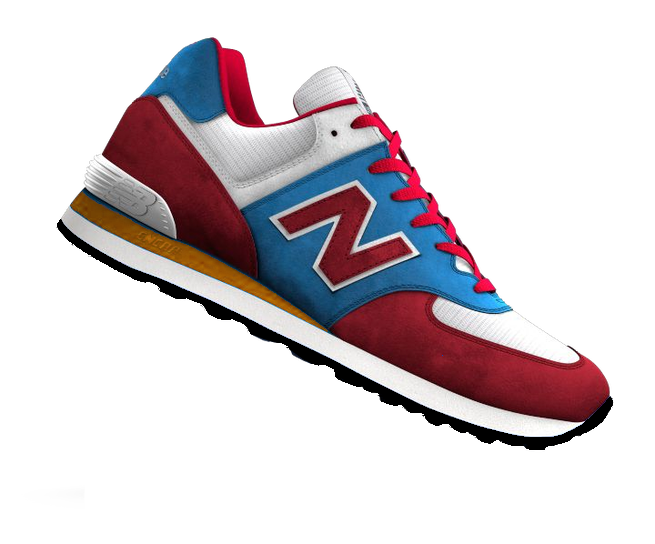

# Tuneado de zapatilla

## Descripción de la práctica
Esta fue nuestra primera práctica evaluada en GIMP. En esta, debimos de tunear un modelo de zapatilla que nos otorgó el profesor. Teníamos que cambiar las diferentes zonas de color de la zapatilla por diferentes texturas o colores, siendo diferentes a los iniciales. Para ello, nuestro profesor nos proporcionó una imagen original para modificar, como podemos ver abajo:

Como podemos observar, la zapatilla tiene diferentes zonas de color (azules, rojas, blancas, amarillentas, etc.). Bien, pues estas zonas debemos de modificarlas de tal forma que cambiemos el color o la textura de una zona en concreto. La idea es que todas las zonas sean diferentes, para que haya variedad. 

## Herramientas utilizadas
Para esta práctica, utilizamos un par de herramientas en GIMP que nos proporcionaban ayuda, facilitando mucho el trabajo. 

### Varita mágica (Selección difusa) 
Esta herramienta, básicamente, nos permite seleccionar las zonas de las zapatillas que nosotros decidamos que queremos cambiar. Para esto, seleccionamos en la parte superior izquierda la herramiente (o presionamos la letra U y nos la selecciona directamente). Cuando queramos seleccionar una zona que cambiar, pulsamos en la zona. Esta, vemos que se selecciona con una línea cerrada, teniendo en cuenta el umbral. El umbral define el grado de similitud que deben poseer los píxeles para ser seleccionados de manera conjunta. Al principio, es posible que no nos seleccione toda la zona deseada. Por eso, mientras pulsamos la tecla Shift (manteniéndola pulsada), debemos de ir seleccionando y haciendo click sobre la zona hasta que todo quede como deseamos. Ahora, debemos utilizar la siguiente herramienta.

### Cortado, copiado y pegado de texturas

